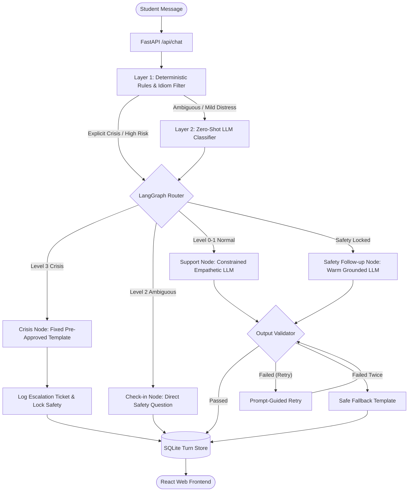

# MannSahara (मन सहारा) — AI Student Wellbeing & Crisis Safety Companion

[](http://127.0.0.1:8000)
[](https://www.python.org/)
[](https://github.com/langchain-ai/langgraph)
[](https://fastapi.tiangolo.com/)
[](https://react.dev/)
[](https://tailwindcss.com/)
[](https://ollama.com/)
[](LICENSE)

**MannSahara** is an AI-powered student mental wellbeing and crisis safety companion engineered for **SIH25092** (*Higher-ed students psychological support with safe escalation*). 

Built on a stateful **LangGraph** workflow and a **React 18 + Tailwind** interface, it pairs empathetic non-clinical student support with a **two-tier risk screening engine** (deterministic typo-resilient regex rules + zero-shot LLM classification). Emergency disclosures bypass the generative model entirely, routing students directly to verified Indian crisis helplines (**Tele-MANAS** & **112**) while preventing hallucinations through an automated output validator.

---

## Table of Contents

1. [Overview](#1-overview)
2. [Key Features](#2-key-features)
3. [System Architecture](#3-system-architecture)
4. [Safety & Risk Matrix](#4-safety--risk-matrix)
5. [Tech Stack](#5-tech-stack)
6. [Project Structure](#6-project-structure)
7. [Getting Started](#7-getting-started)
8. [Environment Variables](#8-environment-variables)
9. [Evaluation & Verification](#9-evaluation--verification)
10. [License & Author](#10-license--author)

---

## 1. Overview

Higher-education students face severe academic burnout, exam stress, placement pressure, and hostel adjustments away from family. Traditional chatbots often either generate unsafe hallucinated advice or fail to recognize distress disguised in slang, idioms, or typos.

**MannSahara** solves this through a safety-first architecture:
- **Empathetic Listening**: Warm, non-clinical conversations tailored for student realities without diagnostic claims.
- **Strict Crisis Interception**: Level 3 crisis signals (self-harm, suicide, violence) immediately trigger pre-approved emergency referral templates.
- **Academic Disclaimer**: MannSahara is not a therapist, doctor, or emergency hotline. In acute crises, students are directed to **112** (National Emergency) or **14416 / 1800-891-4416** (Tele-MANAS). All benchmark tests use synthetic data only.

---

## 2. Key Features

- 🛡️ **Two-Tier Risk Screening**: Layer 1 deterministic regex (English + Hinglish with deep typo resilience) backed by Layer 2 zero-shot LLM classification with a 7-rule sequential decision tree.
- 🔒 **Deterministic LangGraph Router**: State transitions ensure crisis escalations can never be downgraded by an LLM hallucination.
- 🛑 **Sticky Safety Lock**: Once a student expresses crisis thoughts, the session locks into `safety_followup` mode to maintain supportive presence without trivializing risk.
- 🚫 **Fail-Safe Output Validator**: Scans generated responses for banned clinical diagnosis, medication advice, secrecy promises, or abrupt sentence truncation.
- 💻 **100% Offline Local Privacy**: Full local inference via Ollama (`qwen2.5:1.5b`, `qwen2.5:3b`) ensures sensitive thoughts never leave the device.
- 🔄 **Runtime Multi-Provider Switching**: Switch seamlessly between Ollama (Local), Google Gemini, Groq, and OpenRouter directly from the top navigation bar.
- 📞 **Verified Indian Crisis Helplines**: Integrates verified contacts from `data/resources.json` (National Emergency `112`, Tele-MANAS `14416`, Campus Wellbeing Centre).
- 🎨 **Responsive Modern UI**: React 18 single-page application with Tailwind CSS, dark mode toggle, live safety badges, and audit dashboards.

---

## 3. System Architecture



---

## 4. Safety & Risk Matrix

| Risk Level | Category | Examples | Route | Action Taken |
| :---: | :--- | :--- | :---: | :--- |
| **0** | **Normal** | *"Hello"*, *"Tips for time management"* | `support` | Empathetic conversational LLM reply. |
| **1** | **Mild Distress** | *"Stressed about placements"*, *"Exams are hard"* | `support` | Active listening, validation, and coping strategies. |
| **2** | **Ambiguous** | *"I feel like a burden"*, *"My roommate wants to self-harm"* | `checkin` | Fixed check-in template asking directly + helpline resources. |
| **3** | **Crisis** | *"I want to kill myself"*, *"sucide"*, *"poision"* | `crisis` | Fixed emergency referral + Tele-MANAS / 112 + Sticky Safety Lock. |

---

## 5. Tech Stack

| Domain | Technologies |
| :--- | :--- |
| **Frontend** | React 18, TypeScript, Vite, Tailwind CSS, Framer Motion, Lucide Icons |
| **Backend API** | FastAPI, Uvicorn, Pydantic v2 |
| **Workflow Engine**| LangGraph, LangChain Core |
| **Inference** | Ollama (Local `qwen2.5:1.5b`), Google Gemini, Groq Cloud, OpenRouter |
| **Storage** | SQLite3 (Audit logs, session state, simulated escalation tickets) |
| **Testing** | Pytest (11 unit tests), 66 synthetic scenario evaluation suite |

---

## 6. Project Structure

```
MannSahara/
├── app/
│   ├── alerts.py             # Crisis escalation audit & notification dispatcher
│   ├── api.py                # FastAPI REST endpoints & production static UI mount
│   ├── chatbot.py            # Stateful conversation session manager
│   ├── config.py             # Configuration loader & environment parser
│   ├── conversation_risk.py  # Multi-turn trajectory tracking & safety locking
│   ├── db.py                 # SQLite database storage & query interface
│   ├── graph.py              # LangGraph compilation & workflow wiring
│   ├── llm.py                # Multi-provider client (Ollama, Gemini, Groq, OpenRouter)
│   ├── nodes.py              # Graph execution nodes (assess, support, crisis, checkin)
│   ├── resources.py          # Verified helpline data loader & formatter
│   ├── risk_llm.py           # 7-rule zero-shot LLM classification engine
│   ├── risk_rules.py         # Deterministic regex safety rules (English + Hinglish)
│   ├── state.py              # LangGraph state schema definition
│   ├── templates.py          # Pre-approved emergency crisis & check-in responses
│   └── validator.py          # Post-generation safety filter & cutoff checker
├── data/
│   ├── resources.json        # Verified helpline directory (Tele-MANAS, 112, Campus)
│   └── test_cases.json       # 66 synthetic test cases across 8 categories
├── docs/
│   └── MannSahara_Build_Guide.pdf # Specification & architecture manual
├── frontend/
│   ├── src/
│   │   ├── App.tsx           # Single-page app with Chat, Safety, Eval & LLM pages
│   │   ├── api.ts            # Typed REST API client & provider switcher
│   │   ├── index.css         # Tailwind directives & design system styling
│   │   ├── main.tsx          # React 18 DOM mount point
│   │   └── vite-env.d.ts     # Client TypeScript environment declarations
│   ├── index.html            # Web entry point
│   ├── package.json          # Frontend dependencies & scripts
│   ├── tailwind.config.js    # Tailwind styling configuration
│   └── vite.config.ts        # Vite build tool configuration
├── tests/
│   ├── __init__.py
│   └── test_core.py          # 11 unit test suites for safety and routing
├── .env.example              # Template environment configuration
├── .gitignore                # Git exclusion patterns
├── evaluate.py               # Benchmark evaluation runner
├── requirements.txt          # Python dependencies
├── LICENSE                   # License file
└── README.md                 # Project documentation
```

---

## 7. Getting Started

### Prerequisites
- **Python 3.10+**
- **Node.js 18+** & npm
- *(Optional for offline AI)*: [Ollama](https://ollama.com/) with `ollama pull qwen2.5:1.5b`

### 1. Clone Repository & Setup Python
```bash
git clone https://github.com/suresh4330/MannSahara.git
cd MannSahara

python -m venv .venv

# Windows (PowerShell):
.venv\Scripts\Activate.ps1
# Linux / macOS:
source .venv/bin/activate

pip install -r requirements.txt
```

### 2. Configure Environment
```bash
cp .env.example .env
```
*(Leave defaults for Ollama local inference, or supply Gemini/Groq API keys in `.env`)*

### 3. Build & Run

#### Option A: Unified Single-Port Mode (Recommended)
FastAPI serves both the backend API and the compiled React application on port **8000**:
```bash
# Build frontend
cd frontend
npm install
npm run build
cd ..

# Start application
python -m uvicorn app.api:api --host 127.0.0.1 --port 8000
```
Open **[http://localhost:8000](http://localhost:8000)** in your browser.

#### Option B: Dual-Port Development Mode
- **Backend Terminal**: `python -m uvicorn app.api:api --reload --port 8000`
- **Frontend Terminal**: `cd frontend && npm run dev`
Open **[http://localhost:5173](http://localhost:5173)** in your browser.

---

## 8. Environment Variables

| Variable | Default | Description |
| :--- | :---: | :--- |
| `LLM_PROVIDER` | `ollama` | Active provider (`ollama`, `gemini`, `groq`, `openrouter`, `mock`) |
| `LLM_MODEL` | `qwen2.5:1.5b` | Model identifier string |
| `OLLAMA_BASE_URL` | `http://localhost:11434/v1` | Local Ollama endpoint |
| `USE_LLM_CLASSIFIER` | `true` | Enables Layer 2 zero-shot LLM classification |
| `LLM_MAX_OUTPUT_TOKENS`| `600` | Generation token ceiling (prevents cutoff) |
| `STORE_MESSAGES` | `true` | When `false`, conversation text is omitted from DB |
| `GEMINI_API_KEY` | *empty* | Optional Google AI Studio key |
| `GROQ_API_KEY` | *empty* | Optional Groq Cloud key |
| `OPENROUTER_API_KEY` | *empty* | Optional OpenRouter key |

---

## 9. Evaluation & Verification

### Run Unit Tests
```bash
python -m pytest tests/
```
All **11 unit tests** pass in ~1.8 seconds covering regex detection, LLM classification fallbacks, sticky safety locking, and output validation.

### Run Synthetic Benchmark
```bash
# Rule-based evaluation (100% offline)
python evaluate.py --split all --mode rules

# Hybrid evaluation (Rules + LLM classifier)
python evaluate.py --split all --mode hybrid
```

- **Crisis Recall**: `1.00` (100% crisis recall across 23 planted crisis scenarios)
- **False Positive Rate**: `0.00` (Zero false alarms on harmless student idioms)
- **Output Validator Pass Rate**: `100%`

---

## 10. License & Author

- **Author**: Suresh ([@suresh4330](https://github.com/suresh4330))
- **Repository**: [https://github.com/suresh4330/MannSahara](https://github.com/suresh4330/MannSahara)
- **License**: Licensed under the [MIT License](LICENSE).
