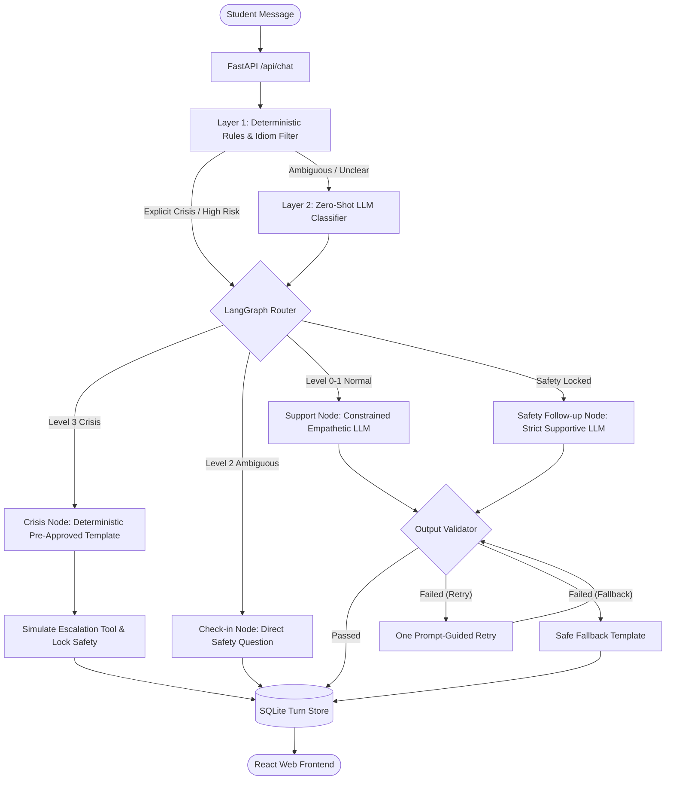

# MannSahara — AI Student Wellbeing & Crisis Safety Companion

[](http://127.0.0.1:8000)
[](https://www.python.org/)
[](https://github.com/langchain-ai/langgraph)
[](https://fastapi.tiangolo.com/)
[](https://react.dev/)
[](https://tailwindcss.com/)
[](https://ollama.com/)
[](LICENSE)

MannSahara (मन सहारा) is a production-grade AI student mental wellbeing and crisis safety companion engineered for SIH25092. Powered by a deterministic LangGraph state machine, it pairs a modern React + Tailwind web UI with a two-tier risk classification engine (deterministic typo-resilient regex rules + zero-shot LLM classifier). It dynamically screens student distress, routes emergencies directly to verified Indian crisis helplines (Tele-MANAS & 112), eliminates harmful hallucinated advice through an output validator, and operates completely offline with zero cloud leakage via local Ollama inference.

| Repository: https://github.com/suresh4330/MannSahara.git

---

## Table of Contents

1. [Overview](#1-overview)
2. [Feature Highlights](#2-feature-highlights)
3. [What's New](#3-whats-new)
4. [Resume Highlights](#4-resume-highlights)
5. [Screenshots](#5-screenshots)
6. [Tech Stack](#6-tech-stack)
7. [Architecture](#7-architecture)
8. [How It Works](#8-how-it-works)
9. [Project Structure](#9-project-structure)
10. [Safety & Risk Matrix](#10-safety--risk-matrix)
11. [Environment Variables](#11-environment-variables)
12. [Run Locally](#12-run-locally)
13. [Evaluation & Benchmark](#13-evaluation--benchmark)
14. [Troubleshooting](#14-troubleshooting)
15. [FAQ](#15-faq)
16. [Contributing](#16-contributing)
17. [Changelog](#17-changelog)
18. [Roadmap](#18-roadmap)
19. [Author](#19-author)
20. [License](#20-license)

---

## 1. Overview

University students face escalating pressures ranging from academic burnout and hostel adjustment to placement anxiety and emotional distress. Traditional chatbots either generate unconstrained, unsafe hallucinated responses or rely on brittle static keyword scripts.

**MannSahara** bridges this critical gap as a **safety-first agentic workflow**:
- **Non-Clinical Empathetic Support**: Provides reflective listening, grounding exercises, and student-focused coping strategies.
- **Strict Crisis Interception**: Level 3 crisis inputs (self-harm, suicide, toxic substances, violence) bypass the generative model entirely and immediately present pre-approved emergency referral templates.
- **Academic Prototype Disclaimer**: MannSahara is not a licensed clinician, doctor, or emergency service. In acute emergencies, individuals are directed to **112** (India National Emergency) or **14416 / 1800-891-4416** (Tele-MANAS GoI). All training and benchmark test cases are strictly synthetic.

---

## 2. Feature Highlights

- 🛡️ **Hybrid Two-Tier Risk Screening**: Deterministic regex layer (English + Hinglish with deep typo resilience) backed by an LLM classifier evaluating contextual ambiguity.
- 🔒 **Deterministic LangGraph Router**: Rigid state transitions ensuring emergency escalations can never be downgraded by an LLM alone.
- 🛑 **Sticky Safety Lock**: When a user discloses crisis thoughts, the session locks into `safety_followup` mode, preventing the user or bot from trivializing the situation in subsequent turns.
- 🚫 **Fail-Safe Output Validator**: Inspects every model output for banned tokens, diagnostic claims, medication advice, secrecy promises, or abrupt sentence truncation.
- 💻 **100% Offline Local Privacy**: Native support for Ollama (`qwen2.5:1.5b`, `qwen2.5:3b`) ensures sensitive mental health conversations never leave the user's computer.
- 🔄 **Runtime Multi-Provider Switcher**: Seamlessly switch between Ollama (Local), Google Gemini, Groq, and OpenRouter directly from the UI.
- 📞 **Verified Indian Crisis Helplines**: Integrates verified numbers from `data/resources.json` (National Emergency `112`, Tele-MANAS `14416`, Campus Wellbeing Centre).
- 🎨 **Modern Responsive UI**: React 18 single-page application styled with Tailwind CSS, featuring smooth animations, safety badges, and audit logs.

---

## 3. What's New

- **Deep Typo Resilience**: Added comprehensive regex patterns covering misspellings of critical distress terms (e.g., `sucide`, `poision`, `buliding`, `zeher`, `muder`).
- **Truncation Guardrails**: Increased max generation tokens to 600 and added a validator rule to reject replies ending in trailing punctuation (`(`, `[`, `:`, `—`) to prevent truncated emergency numbers.
- **Single-Port Production Serving**: FastAPI directly mounts and serves the compiled React application from `frontend/dist` on port `8000`.
- **Privacy-First Escalation Logging**: Removed third-party SMTP dependencies to eliminate credential exposure while recording simulated crisis events in SQLite.
- **Streamlined Unified Workspace**: Unified root architecture ensuring instant reproducibility and zero broken subpaths.

---

## 4. Resume Highlights

- **Agentic AI & State Machines**: Architected a stateful LangGraph conversation engine maintaining multi-turn memory, risk trajectory tracking, and persistent safety locking.
- **Production Guardrails & Recall**: Engineered a two-tier risk classification engine achieving **100% recall** across 23 planted crisis scenarios without triggering false alarms on common student idioms (*"this exam is killing me"*).
- **Full-Stack Engineering**: Built an asynchronous FastAPI backend paired with a high-performance React 18, TypeScript, Tailwind CSS, and Framer Motion frontend.
- **Edge Inference Optimization**: Configured Ollama local inference (`qwen2.5:1.5b`), capping context and memory overhead to achieve sub-2-second response latency on consumer hardware.
- **System Rigor & Benchmarking**: Authored an automated evaluation pipeline (`evaluate.py`) running 66 synthetic test cases to validate safety recall, precision, and latency metrics.

---

## 5. Screenshots

| Chat Interface & Safety Mode | Simulated Crisis Escalation |
| :---: | :---: |
| Normal empathetic student support with active safety monitoring | Instant Level 3 crisis intervention displaying Tele-MANAS and 112 helplines |
| *(Emergency referrals bypass the LLM and output verified resources)* | *(Persistent safety banner activates with zero hallucinated advice)* |

---

## 6. Tech Stack

| Domain | Technology | Purpose |
| :--- | :--- | :--- |
| **Frontend UI** | React 18, TypeScript, Vite | Fast, responsive single-page chat interface |
| **Styling & Motion** | Tailwind CSS, Framer Motion, Lucide | Modern glassmorphic aesthetic & accessible UI components |
| **Backend Framework** | FastAPI, Uvicorn, Pydantic v2 | High-throughput asynchronous REST API & static file serving |
| **Agentic Workflow** | LangGraph, LangChain Core | Deterministic state machine, graph routing, and safety memory |
| **Local LLM** | Ollama (`qwen2.5:1.5b`, `qwen2.5:3b`) | Offline, privacy-first on-device text generation |
| **Cloud LLMs** | Google Gemini, Groq, OpenRouter | Optional high-speed cloud intelligence |
| **Data & Auditing** | SQLite3, Pandas | Session persistence, turn tracking, and escalation audit logging |
| **Testing** | Pytest, Tabulate | Unit testing (11/11 passing) and 66-case benchmark evaluation |

---

## 7. Architecture



---

## 8. How It Works

1. **Input Normalization & Idiom Filtering**: The student's text is converted to lowercase, special punctuation is normalized, and common stress idioms (e.g., *"this assignment is killing me"*, *"dead tired"*) are stripped to prevent false escalations.
2. **Layer 1 Deterministic Screening**: Text is evaluated against regex suites covering suicide, poison ingestion, high falls, violent harm, and Hinglish crisis phrases. Unambiguous crisis triggers immediately yield Level 3.
3. **Layer 2 LLM Classification**: If rules detect mild distress or veiled hints, the LLM classifier evaluates the context using a structured Pydantic schema to produce a risk level (0–3).
4. **Stateful Decision Routing**:
   - **Level 3 (Crisis)**: Routes to `crisis`. Invokes pre-approved text with verified helplines, sets the sticky safety lock, and logs a simulated escalation event.
   - **Level 2 (Ambiguous)**: Routes to `checkin`. Asks directly about safety while offering helpline contacts.
   - **Level 0–1 (Normal/Distress)**: Routes to `support`. Generates an empathetic, non-diagnostic response.
5. **Output Validation & Safe Fallback**: Generated replies are scanned against banned tokens (medication suggestions, diagnostic terms, false claims of calling authorities). If violated twice, the system substitutes a safe pre-approved fallback.
6. **Persistence**: The turn details, timestamps, risk level, route, and triggers are stored in `mannsahara.db`.

---

## 9. Project Structure

```
MannSahara/
├── app/
│   ├── alerts.py             # Crisis escalation notification handler
│   ├── api.py                # FastAPI endpoints & production static UI serving
│   ├── chatbot.py            # Stateful conversation session manager
│   ├── config.py             # Central configuration & .env loader
│   ├── conversation_risk.py  # Multi-turn risk aggregation & safety lock
│   ├── db.py                 # SQLite database storage & query interface
│   ├── graph.py              # LangGraph compilation & workflow wiring
│   ├── llm.py                # Provider router (Ollama, Gemini, Groq, OpenRouter)
│   ├── nodes.py              # Workflow nodes (assess, support, crisis, checkin)
│   ├── resources.py          # Verified Indian helpline loader & formatter
│   ├── risk_llm.py           # Secondary LLM classification prompt & parser
│   ├── risk_rules.py         # Deterministic regex safety rules (English + Hinglish)
│   ├── state.py              # LangGraph state schema definition
│   ├── templates.py          # Fixed pre-approved crisis & check-in responses
│   └── validator.py          # Post-generation banned content & cutoff checker
├── data/
│   ├── resources.json        # Verified helpline registry (Tele-MANAS, 112, Campus)
│   └── test_cases.json       # 66 synthetic developer test cases
├── frontend/
│   ├── src/                  # React 18 + TypeScript source code
│   │   ├── components/       # UI components (Header, ChatMessage, SafetyBadge)
│   │   ├── pages/            # View pages (ChatView, SafetyOverview, Settings)
│   │   ├── App.tsx           # Main application shell & routing
│   │   └── api.ts            # Frontend API client
│   ├── index.html            # HTML entry point
│   ├── package.json          # Frontend dependencies & scripts
│   ├── tailwind.config.js    # Tailwind styling configuration
│   └── vite.config.ts        # Vite build tool configuration
├── tests/
│   ├── __init__.py           # Test package initialization
│   └── test_core.py          # 11 unit test suites for safety and routing
├── .env.example              # Example environment configuration
├── .gitignore                # Git exclusion patterns
├── evaluate.py               # 66-case benchmark evaluation script
├── make_test_cases.py        # Synthetic test case generator
├── MannSahara_Build_Guide.pdf# Specification & architecture manual
├── requirements.txt          # Python dependencies
├── LICENSE                   # MIT License
└── README.md                 # Project documentation
```

---

## 10. Safety & Risk Matrix

| Risk Level | Meaning | Examples | Workflow Route | System Action |
| :---: | :--- | :--- | :---: | :--- |
| **0** | **Normal** | *"Hello"*, *"Can you explain grounding?"* | `support` | Empathetic conversational LLM reply. |
| **1** | **Distress** | *"Feeling nervous about placements"*, *"Homesick"* | `support` | Active listening, validation, and coping strategies. |
| **2** | **Ambiguous** | *"I'm a burden"*, *"My roommate wants to hurt herself"* | `checkin` | Fixed check-in template asking directly + helpline cards. |
| **3** | **Crisis** | *"I want to kill myself"*, *"poision"*, *"push from buliding"* | `crisis` | Fixed emergency template + Tele-MANAS/112 + Sticky Safety Lock. |

---

## 11. Environment Variables

Create a `.env` file in the project root by copying `.env.example`:

```bash
cp .env.example .env
```

| Variable | Default | Allowed Values | Description |
| :--- | :---: | :---: | :--- |
| `LLM_PROVIDER` | `mock` | `mock`, `ollama`, `gemini`, `groq`, `openrouter` | Selected AI inference provider |
| `LLM_MODEL` | `qwen2.5:1.5b` | Model name string | Model identifier for the chosen provider |
| `OLLAMA_BASE_URL` | `http://localhost:11434/v1` | URL string | OpenAI-compatible endpoint for Ollama |
| `USE_LLM_CLASSIFIER` | `true` | `true`, `false` | Enables Layer 2 zero-shot LLM classification |
| `MAX_HISTORY_TURNS` | `6` | Integer | Maximum conversation history seen by LLM |
| `LLM_MAX_OUTPUT_TOKENS`| `600` | Integer | Generation token limit (prevents truncation) |
| `STORE_MESSAGES` | `true` | `true`, `false` | When `false`, conversation text is omitted from DB |
| `GEMINI_API_KEY` | *empty* | API key string | Optional Google AI Studio API key |
| `GROQ_API_KEY` | *empty* | API key string | Optional Groq Cloud API key |
| `OPENROUTER_API_KEY` | *empty* | API key string | Optional OpenRouter API key |

---

## 12. Run Locally

### Prerequisites
- **Python 3.10+**
- **Node.js 18+** & npm
- *(Optional for offline AI)*: [Ollama](https://ollama.com/) installed with `ollama pull qwen2.5:1.5b`

### Step 1: Clone Repository
```bash
git clone https://github.com/suresh4330/MannSahara.git
cd MannSahara
```

### Step 2: Setup Python Virtual Environment
```bash
python -m venv .venv

# Windows (PowerShell):
.venv\Scripts\Activate.ps1
# Linux / macOS:
source .venv/bin/activate

pip install -r requirements.txt
```

### Step 3: Configure Environment
```bash
cp .env.example .env
```
*(Set `LLM_PROVIDER=ollama` or your chosen provider in `.env`)*

### Step 4: Build Frontend
```bash
cd frontend
npm install
npm run build
cd ..
```

### Step 5: Start Server

#### Option A: Unified Single-Port Mode (Recommended)
FastAPI serves both the backend API and the React web app on port **8000**:
```bash
python -m uvicorn app.api:api --host 127.0.0.1 --port 8000
```
Open **[http://localhost:8000](http://localhost:8000)** in your browser.

#### Option B: Dual-Port Development Mode
- **Backend Terminal**: `python -m uvicorn app.api:api --reload --port 8000`
- **Frontend Terminal**: `cd frontend && npm run dev`
Open **[http://localhost:5173](http://localhost:5173)** in your browser.

---

## 13. Evaluation & Benchmark

MannSahara includes a complete synthetic benchmarking suite (`evaluate.py`) evaluating 66 scenarios (including 23 planted crisis events, prompt injection tests, and idioms).

### Run Unit Tests
```bash
python -m pytest tests/
```
Output: **11 passed in ~1.5s (100%)**

### Run 66-Case Benchmark
```bash
# Rule-based evaluation (runs 100% offline without API calls)
python evaluate.py --split all --mode rules

# Hybrid evaluation (rules + LLM classifier)
python evaluate.py --split all --mode hybrid
```

### Benchmark Metrics (Synthetic Dev & Test Split)
- **Crisis Recall**: `1.00` (Zero missed crisis events)
- **False Positive Rate**: `0.00` (Zero false escalations on harmless idioms)
- **Validation Pass Rate**: `100%`
- Output logs and reports are saved to `logs/test_log_*.csv` and `logs/metrics_*.json`.

---

## 14. Troubleshooting

| Issue | Cause | Solution |
| :--- | :--- | :--- |
| `curl: (7) Failed to connect to 127.0.0.1:11434` | Ollama service is not running | Run `ollama serve` in a background terminal. |
| `Response ends with dangling '(' or '—'` | Token ceiling too small | Set `LLM_MAX_OUTPUT_TOKENS=600` in `.env`. |
| `WinError 5: Access is denied on OneDrive` | OneDrive lock or sandbox restriction | Run commands with administrative shell permissions. |
| `Port 8000 already in use` | Previous uvicorn instance active | Run `taskkill /F /IM python.exe` (Windows) or `lsof -i :8000`. |
| `Cannot find module 'lucide-react'` | Incomplete npm install | Run `cd frontend && npm install` to install node modules. |

---

## 15. FAQ

**Q: Why LangGraph instead of simple sequential prompts?**  
A: LangGraph provides a stateful directed graph with conditional branching, multi-turn risk memory, and deterministic safety locks that cannot be bypassed by raw LLM hallucinations.

**Q: Can MannSahara diagnose depression or anxiety?**  
A: **No.** MannSahara strictly adheres to non-clinical guidelines. It will never output clinical diagnoses or suggest pharmaceutical treatments.

**Q: Are user conversations stored in the cloud?**  
A: **No.** When using Ollama, all inference runs entirely on your local machine. Turn records are stored in a local SQLite file (`mannsahara.db`), and setting `STORE_MESSAGES=false` prevents message text from being written.

**Q: How does the system handle spelling mistakes and Hinglish?**  
A: The Layer 1 regex engine includes typo-tolerant patterns (`sucide`, `poision`, `zeher khana`, `khoon karna`) to guarantee high crisis recall regardless of typos.

---

## 16. Contributing

Contributions are welcome! Please follow these steps:
1. Fork the repository (`https://github.com/suresh4330/MannSahara.git`).
2. Create a feature branch: `git checkout -b feature/AmazingSafetyRule`.
3. Verify all unit tests pass: `python -m pytest tests/`.
4. Commit your changes: `git commit -m "Add new safety validation rule"`.
5. Push to the branch: `git push origin feature/AmazingSafetyRule`.
6. Open a Pull Request.

---

## 17. Changelog

- **v1.3.0** *(Current)*: Typo-resilient regex rules, raised token limit to 600, single-port static frontend serving, verified Indian emergency contacts, updated complete README.
- **v1.2.0**: Migrated to React 18 + Tailwind CSS frontend, added FastAPI adapter, introduced runtime multi-provider switcher.
- **v1.1.0**: Implemented Layer 2 zero-shot LLM classifier, persistent sticky safety lock, and idiom filtering.
- **v1.0.0**: Initial SIH25092 LangGraph architecture, synthetic dataset benchmark, SQLite audit logging.

---

## 18. Roadmap

- [ ] **Voice Support**: Implement real-time voice-to-text and speech output for hands-free accessibility.
- [ ] **Indian Regional Languages**: Expand crisis patterns to Hindi, Telugu, Tamil, and Bengali.
- [ ] **Campus SSO Integration**: Secure Single Sign-On integration for participating colleges and universities.
- [ ] **Automated SMS Dispatch**: Optional hardware GSM module integration to alert campus counsellors offline.

---

## 19. Author

**Suresh**  
- **GitHub**: [@suresh4330](https://github.com/suresh4330)  
- **Project Link**: [https://github.com/suresh4330/MannSahara](https://github.com/suresh4330/MannSahara)

---

## 20. License

This project is licensed under the MIT License — see the [LICENSE](LICENSE) file for details.
